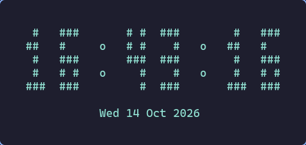
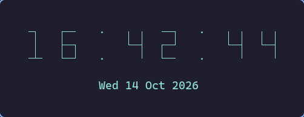
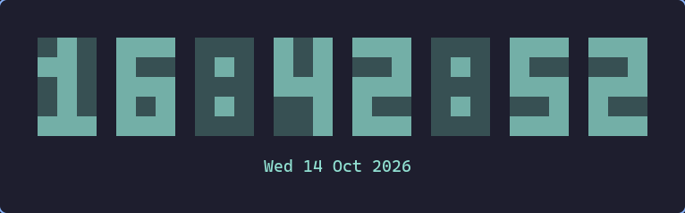
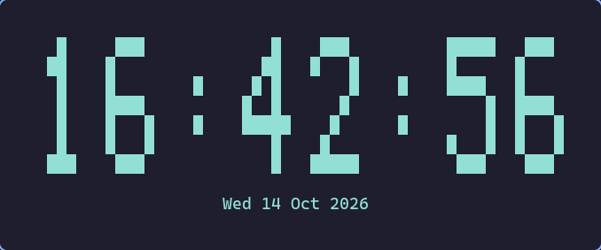

<div align="center">

# cliclock

**A terminal clock with big, colourful digits. Six styles, live reload, zero dependencies.**

[](LICENSE)


</div>

| `block` (default) | `slim` |
| :---: | :---: |
|  |  |
| **`thin`** | **`led`** |
|  |  |
| **`ghost`** | **`tall`** |
|  |  |

## Features

- **Six digit styles**, from a compact 3-row box-drawing font to a 7-row giant.
- **Live reload**: edit the config (or use the settings menu in another terminal) and the running clock restyles itself on the next tick.
- Blinking or cycling separator, 12/24-hour time, optional seconds and date, seven colours.
- Interactive settings menu with instant saving.
- Clean terminal behaviour: draws on the alternate screen, leaves no scrollback, restores everything on exit.
- Pure Python 3 standard library. No pip, no build step.
- Optional Hyprland helper that opens the clock in a small floating window sized to the chosen style.

## Quick start

```bash
git clone https://github.com/airenare/cliclock.git
cd cliclock
./install.sh        # installs to ~/.local, no root needed
cliclock
```

Press <kbd>Ctrl</kbd>+<kbd>C</kbd> to quit. Try a style without saving anything:

```bash
cliclock --set digit_style=ghost --set show_date=true
```

On Arch you can build a package instead: `makepkg -si`.

## Usage

| flag | meaning |
|---|---|
| *(none)* | run the clock until Ctrl-C (or SIGTERM) |
| `--set KEY=VALUE` | override a setting for this run; repeatable |
| `--12h` / `--24h` | force 12-hour (with AM/PM) or 24-hour time for this run |
| `--once` | print one frame and exit |
| `--settings [PATH]` | open the settings menu on a terminal; otherwise print the resolved settings |
| `--no-menu` | with `--settings`: only print, never prompt |
| `--save` | write the resolved settings to the config file |
| `--reset` | delete the config file |
| `--config PATH` | use another config file |
| `--version`, `--help` | what they say |

```bash
cliclock --12h --set digit_style=slim
cliclock --set tick_style=cycle --save     # make it permanent
cliclock --settings                        # interactive menu
```

## Configuration

Settings live in `$XDG_CONFIG_HOME/cliclock/config.toml` (default `~/.config/cliclock/config.toml`). A missing file is fine; these are the defaults:

```toml
digit_style = "block"
twelve_hour = false
show_seconds = true
show_date = false
tick_style = "blink"
color = true
refresh_seconds = 1.0
date_format = "%a %d %b %Y"
color_name = "cyan"
```

| field | values |
|---|---|
| `digit_style` | `block`, `slim`, `thin`, `led`, `ghost`, `tall` |
| `twelve_hour`, `show_seconds`, `show_date`, `color` | `true` / `false` |
| `tick_style` | `blink` (colon flashes), `cycle` (dot walks around) |
| `refresh_seconds` | number greater than 0 |
| `date_format` | any non-empty `strftime` format |
| `color_name` | `red`, `green`, `yellow`, `blue`, `magenta`, `cyan`, `white` |

Precedence: defaults < config file < `--set` / `--12h` / `--24h`. Invalid values, unknown keys and malformed TOML print a one-line warning and fall back to the default.

### Live reload

The running clock checks the config file once per tick (a single `stat()`, parsed only when it changes) and applies edits on the next redraw. Command-line overrides keep priority over the file. A file that is invalid or half-written is ignored, so a typo never breaks a running clock. Saves are atomic.

### Settings menu

`cliclock --settings` opens a small menu when run in a terminal:

```
cliclock settings
config: /home/you/.config/cliclock/config.toml
  1. digit_style           = block            (block | slim | thin | led | ghost | tall)
  ...
change [number|key]  s=save  d=defaults  q=quit>
```

Type a setting's number or name, then its new value (empty keeps the current one). Every accepted change is saved immediately. `d` resets everything to defaults, `q` or Ctrl-D quits.

## Hyprland floating window

`contrib/hyprland/` has two scripts that open the clock in a small floating [Ghostty](https://ghostty.org) window with equal padding on all sides, resized and centred for whichever style is active (it follows live style changes too).

```bash
install -m 755 contrib/hyprland/cliclock-* ~/.local/bin/
cliclock-window                                # or: cliclock-window --set digit_style=tall
```

Bind it in your Hyprland config, for example `hl.bind("SUPER + SHIFT + X", hl.dsp.exec_cmd("cliclock-window"))` in the Lua format.

How it works: when `CLICLOCK_ON_SIZE` is set, cliclock runs `$CLICLOCK_ON_SIZE COLS ROWS` whenever its frame size changes, and `cliclock-fit-window` turns that into a window size. The pixel metrics are calibrated for Ghostty at font size 14; adjust `CELL_W`, `CELL_H` and `OVERHEAD` in `cliclock-fit-window` if yours differ. Requires `hyprctl`, `jq` and `ghostty`, and uses Hyprland's Lua dispatcher syntax.

## Install options

| | command | installs to |
|---|---|---|
| user | `./install.sh` | `~/.local/bin`, `~/.local/lib/cliclock` |
| system | `sudo ./install.sh` | `/usr/local/...` |
| custom | `./install.sh --prefix DIR` | `DIR/bin`, `DIR/lib/cliclock` |
| Arch package | `makepkg -si` | `/usr/bin`, `/usr/lib/cliclock` |

Nothing is written outside the prefix and your config is never touched. If `~/.local/bin` is not on your `PATH`, the installer tells you how to add it.

Uninstall with `./uninstall.sh` (add `sudo` for a system install) or `sudo pacman -R cliclock`.

## Development

```bash
./bin/cliclock                          # run from the checkout
python3 -m unittest discover -s tests   # run the tests
```

```
cliclock/
  cli.py      argument parsing, run loop, hot reload, settings menu
  config.py   Settings dataclass, TOML load / atomic save
  render.py   fonts and frame composition (render_frame, frame_size)
contrib/hyprland/   optional window helpers
packaging/          launcher used by install.sh and the PKGBUILD
tests/              unit and packaging tests
```

Adding a font means adding a `_xxx_font()` to `render.py`, registering it in `FONTS` and in `digit_style`'s allowed values in `config.py`.

See [CHANGELOG.md](CHANGELOG.md) for release notes.

## License

[MIT](LICENSE)
